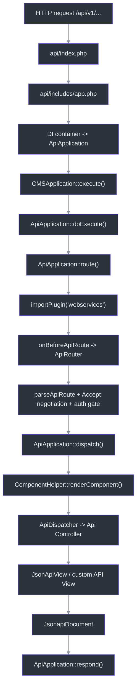
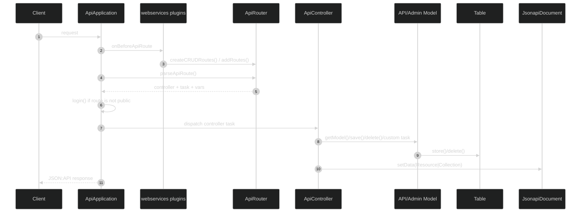

---
title: "Joomla 6 REST API: полный разбор по коду ядра"
description: "Единая статья по Joomla 6.0.3 REST API: ApiApplication, webservices plugins, маршрутизация, API MVC, ACL, trigger'ы и шаблон собственного CRUD endpoint."
---

# Joomla 6 REST API: полный разбор по коду ядра

Статья собрана только по исходному коду Joomla 6.0.3 из каталога `Joomla Core 6.0.3 (version-pinned source snapshot)`. Ниже нет опоры на локальную документацию, только на код и его фактические связи.

Joomla 6 строит REST API не как надстройку над site-приложением и не как отдельный набор контроллеров без инфраструктуры. У API есть собственное приложение `ApiApplication`, собственный этап регистрации маршрутов через плагины группы `webservices`, отдельный MVC-слой в `api/components`, а для моделей и таблиц допускается переиспользование административного кода через `ApiMVCFactory` (`api/index.php:31`, `api/includes/app.php:43`, `libraries/src/Application/ApiApplication.php:40`, `libraries/src/MVC/Factory/ApiMVCFactory.php:23`).

## Общая архитектура





## 1. Вход в API и запуск `ApiApplication`

Вход начинается в `api/index.php`: файл задает минимальную версию PHP, определяет `_JEXEC` и передает управление в `api/includes/app.php` (`api/index.php:13`, `api/index.php:28`, `api/index.php:31`).

`api/includes/app.php` подключает `api/includes/defines.php`, затем `api/includes/framework.php`, берет из DI-контейнера экземпляр `ApiApplication`, делает его глобальным приложением и вызывает `execute()` (`api/includes/app.php:20`, `api/includes/app.php:22`, `api/includes/app.php:27`, `api/includes/app.php:43`, `api/includes/app.php:50`).

Здесь важно, как устроены пути. В API-клиенте `JPATH_BASE` указывает на каталог `/api`, а `JPATH_ROOT` и `JPATH_ADMINISTRATOR` считаются относительно корня сайта. Поэтому API одновременно видит:

- собственные API-классы в `api/components/...`
- административные component providers, models и tables в `administrator/components/...`

Это видно по `api/includes/defines.php` (`api/includes/defines.php:13`, `api/includes/defines.php:20`, `api/includes/defines.php:24`, `api/includes/defines.php:31`).

Сам `ApiApplication` регистрируется сервис-провайдером приложения. Контейнер создает его, подключает dispatcher, logger, session и menu factory, после чего объект становится стандартной точкой выполнения API-запроса (`libraries/src/Service/Provider/Application.php:177`).

## 2. Верхний цикл выполнения

`ApiApplication` наследует `CMSApplication`, поэтому верхний цикл идет через `CMSApplication::execute()`. Этот метод:

- делает системную подготовку;
- импортирует группы плагинов `behaviour` и `system`;
- диспатчит `onBeforeExecute`;
- вызывает `doExecute()`;
- рендерит document;
- диспатчит `onBeforeRespond` и `onAfterRespond`;
- отправляет ответ клиенту

(`libraries/src/Application/CMSApplication.php:297`, `libraries/src/Application/CMSApplication.php:306`, `libraries/src/Application/CMSApplication.php:309`, `libraries/src/Application/CMSApplication.php:319`, `libraries/src/Application/CMSApplication.php:349`, `libraries/src/Application/CMSApplication.php:356`).

Внутри `ApiApplication::doExecute()` API-логика предельно короткая: сначала `initialiseApp()`, потом `route()`, потом `dispatch()` (`libraries/src/Application/ApiApplication.php:91`).

Это важный архитектурный сигнал ядра: HTTP-маршрутизация, negotiation и auth gate происходят до компонентного MVC; component dispatch и JSON:API serialization происходят после них.

## 3. Как API собирает маршруты

### 3.1. Роль `webservices` plugins

В `ApiApplication::route()` контейнер отдает `ApiRouter`, затем Joomla импортирует группу плагинов `webservices` и диспатчит событие `onBeforeApiRoute`, передавая в него router (`libraries/src/Application/ApiApplication.php:229`, `libraries/src/Application/ApiApplication.php:234`, `libraries/src/Application/ApiApplication.php:237`).

`PluginHelper::importPlugin()` выбирает опубликованные плагины нужной группы, а `PluginHelper::import()` грузит каждый плагин через `bootPlugin()` и регистрирует его listeners/subscribers в dispatcher (`libraries/src/Plugin/PluginHelper.php:148`, `libraries/src/Plugin/PluginHelper.php:179`, `libraries/src/Plugin/PluginHelper.php:221`, `libraries/src/Plugin/PluginHelper.php:241`).

Современный core-паттерн для таких плагинов выглядит так:

1. manifest с `group="webservices"` и namespace в `src` (`plugins/webservices/content/content.xml:2`)
2. `services/provider.php`, который кладет plugin в контейнер (`plugins/webservices/content/services/provider.php:20`)
3. класс плагина в `src/Extension/...`, реализующий `SubscriberInterface` (`plugins/webservices/content/src/Extension/Content.php:28`)

Если плагин реализует `SubscriberInterface`, `CMSPlugin::registerListeners()` просто добавляет его в dispatcher как subscriber (`libraries/src/Plugin/CMSPlugin.php:298`).

### 3.2. Что делает `onBeforeApiRoute`

`BeforeApiRouteEvent` жестко требует аргумент `router` и отдает его через `getRouter()` (`libraries/src/Event/Application/BeforeApiRouteEvent.php:17`).

Типовой webservice plugin подписывается на `onBeforeApiRoute` через `getSubscribedEvents()` и в самом обработчике добавляет routes. Например, `content` регистрирует статьи, категории, fields и contenthistory (`plugins/webservices/content/src/Extension/Content.php:37`, `plugins/webservices/content/src/Extension/Content.php:53`).

Именно здесь в Joomla 6 определяется HTTP-поверхность REST API. Не в контроллере. Не в component provider. Не в роутере компонента site-side. Только в `webservices` plugin.

## 4. Как устроен CRUD helper и когда он не подходит

`ApiRouter::createCRUDRoutes()` создает ровно пять маршрутов:

1. `GET <base>` -> `controller.displayList`
2. `GET <base>/:id` -> `controller.displayItem`
3. `POST <base>` -> `controller.add`
4. `PATCH <base>/:id` -> `controller.edit`
5. `DELETE <base>/:id` -> `controller.delete`

Для `GET` defaults автоматически дополняются `public => $publicGets`, а для `POST/PATCH/DELETE` берутся исходные defaults без этой добавки (`libraries/src/Router/ApiRouter.php:51`).

Это и есть базовый ядровой путь для CRUD:

```php
$router->createCRUDRoutes(
    'v1/content/articles',
    'articles',
    ['component' => 'com_content']
);
```

Точно так же сделаны стандартные CRUD endpoints у `content`, `users`, `menus`, `tags`, `redirect` и других core-плагинов (`plugins/webservices/content/src/Extension/Content.php:57`, `plugins/webservices/users/src/Extension/Users.php:56`, `plugins/webservices/menus/src/Extension/Menus.php:56`, `plugins/webservices/tags/src/Extension/Tags.php:55`, `plugins/webservices/redirect/src/Extension/Redirect.php:55`).

Но helper покрывает только случай "числовой id". Как только нужно что-то сложнее, ядро пишет `Route` вручную.

| Сценарий | Как делает core |
| --- | --- |
| нечисловой ключ | `languages` использует regex `([A-Z0-9_]+)` для overrides (`plugins/webservices/languages/src/Extension/Languages.php:87`) |
| path вместо id | `media` строит routes по `:path` и regex `.*` / `.*\/` (`plugins/webservices/media/src/Extension/Media.php:95`) |
| отдельные service actions | `config` и `joomlaupdate` добавляют ручные `Route` с собственными `controller.task` (`plugins/webservices/config/src/Extension/Config.php:52`, `plugins/webservices/joomlaupdate/src/Extension/Joomlaupdate.php:42`) |
| динамические маршруты | `languages` сначала читает административную модель `Languages`, потом генерирует набор URL на каждый язык (`plugins/webservices/languages/src/Extension/Languages.php:75`) |

## 5. Что делает `ApiApplication::route()` после регистрации routes

После `onBeforeApiRoute` приложение:

1. обрабатывает preflight через `handlePreflight()`;
2. вызывает `ApiRouter::parseApiRoute($method)`;
3. делает content negotiation по `Accept`;
4. пишет `controller`, `task` и route vars в input;
5. диспатчит `onAfterApiRoute`;
6. если route не `public`, требует successful login с действием `core.login.api`

(`libraries/src/Application/ApiApplication.php:246`, `libraries/src/Application/ApiApplication.php:248`, `libraries/src/Application/ApiApplication.php:255`, `libraries/src/Application/ApiApplication.php:287`, `libraries/src/Application/ApiApplication.php:310`, `libraries/src/Application/ApiApplication.php:315`).

`parseApiRoute()` возвращает не компонент целиком, а тройку:

- `controller`
- `task`
- `vars`

где `vars` состоят из route defaults плюс path-параметры (`libraries/src/Router/ApiRouter.php:89`).

Это значит, что webservice plugin управляет не только URL, но и тем, какие default values попадут в MVC-слой. Core активно этим пользуется:

- `component => com_content` для обычного CRUD (`plugins/webservices/content/src/Extension/Content.php:57`)
- `extension => com_content` у категорий content (`plugins/webservices/content/src/Extension/Content.php:63`)
- `context => com_content.article` у полей (`plugins/webservices/content/src/Extension/Content.php:85`)
- `component_name` у `config` (`plugins/webservices/config/src/Extension/Config.php:60`)
- `type_alias` и `type_id` у contenthistory (`plugins/webservices/content/src/Extension/Content.php:121`)
- `lang_code` и `app` у language overrides (`plugins/webservices/languages/src/Extension/Languages.php:92`)

## 6. От route к компоненту и API MVC

После маршрутизации `ApiApplication::dispatch()` грузит document, диспатчит `onAfterInitialiseDocument`, вызывает `ComponentHelper::renderComponent($component)` и затем `onAfterDispatch` (`libraries/src/Application/ApiApplication.php:421`, `libraries/src/Application/ApiApplication.php:427`, `libraries/src/Application/ApiApplication.php:433`, `libraries/src/Application/ApiApplication.php:437`).

`ComponentHelper::renderComponent()` делает три ключевые вещи:

1. определяет `JPATH_COMPONENT` как `JPATH_BASE . '/components/' . $option`
2. проверяет, что компонент включен
3. запускает `bootComponent($option)->getDispatcher($app)->dispatch()`

(`libraries/src/Component/ComponentHelper.php:313`, `libraries/src/Component/ComponentHelper.php:349`, `libraries/src/Component/ComponentHelper.php:355`).

### 6.1. Почему component provider берется из `administrator`

`bootComponent()` всегда идет в `administrator/components/com_xxx/services/provider.php`. Это жестко зашито в `ExtensionManagerTrait::bootComponent()` (`libraries/src/Extension/ExtensionManagerTrait.php:42`).

Отсюда следствие: базовый service container компонента для administrator и API общий. Именно поэтому component provider должен жить в административной части.

### 6.2. Как выбирается dispatcher

`ComponentDispatcherFactory` пытается найти класс `...\Api\Dispatcher\Dispatcher`. Если его нет, а приложение — API, подставляется общий `ApiDispatcher` (`libraries/src/Dispatcher/ComponentDispatcherFactory.php:67`).

`ApiDispatcher`:

- читает `task` из input;
- строит controller config;
- выбирает controller с префиксом текущего приложения, то есть `Api`;
- вызывает `execute($task)`

(`libraries/src/Dispatcher/ApiDispatcher.php:44`).

### 6.3. Как выбираются controller, view, model и table

Здесь проходит граница, которую важно не путать.

| Слой | Где ищет ядро | Есть ли fallback |
| --- | --- | --- |
| controller | `...\Api\Controller\...` | нет |
| view | `...\Api\View\...` | нет |
| model | сначала `Api`, потом `Administrator` | да |
| table | сначала `Api`, потом `Administrator` | да |

Доказательство:

- `MVCFactory::createController()` ищет controller только по текущему prefix (`libraries/src/MVC/Factory/MVCFactory.php:84`)
- `MVCFactory::createView()` ищет view только по текущему prefix (`libraries/src/MVC/Factory/MVCFactory.php:181`)
- `ApiMVCFactory::createModel()` и `createTable()` сначала пробуют `Api`, потом повторяют поиск с префиксом `Administrator` (`libraries/src/MVC/Factory/ApiMVCFactory.php:23`, `libraries/src/MVC/Factory/ApiMVCFactory.php:34`, `libraries/src/MVC/Factory/ApiMVCFactory.php:46`, `libraries/src/MVC/Factory/ApiMVCFactory.php:57`)

### 6.4. Важная граница: `Site` модели сюда не входят

Для стандартного REST API fallback идет только `Api -> Administrator`. `Site` модели автоматически в этот путь не попадают. Это видно по самому `ApiMVCFactory`: он повторяет поиск только с префиксом `Administrator`, не с `Site` (`libraries/src/MVC/Factory/ApiMVCFactory.php:34`, `libraries/src/MVC/Factory/ApiMVCFactory.php:57`).

Поэтому формулировка "CRUD в API наследуются от site-side моделей" неверна. Корректно так:

- API-контроллеры и API-view classes должны существовать отдельно в `api/components`
- модели и таблицы API могут не дублироваться, если подходит административный код
- site-side модели в стандартный REST resolution chain не встроены

## 7. JSON:API response layer

Базовый `JsonApiView` строит `Resource` или `Collection`, добавляет pagination links и кладет результат в document (`libraries/src/MVC/View/JsonApiView.php:103`, `libraries/src/MVC/View/JsonApiView.php:145`, `libraries/src/MVC/View/JsonApiView.php:196`, `libraries/src/MVC/View/JsonApiView.php:200`, `libraries/src/MVC/View/JsonApiView.php:249`).

`JsonapiDocument`:

- задает MIME type `application/vnd.api+json`
- принимает `ElementInterface` через `setData()`
- на `render()` просто `json_encode()`-ит JSON:API document

(`libraries/src/Document/JsonapiDocument.php:35`, `libraries/src/Document/JsonapiDocument.php:48`, `libraries/src/Document/JsonapiDocument.php:57`, `libraries/src/Document/JsonapiDocument.php:140`).

Сам document выбирается из `format`, который `ApiApplication::route()` записывает в input после content negotiation (`libraries/src/Application/ApiApplication.php:279`, `libraries/src/Factory.php:762`, `libraries/src/Factory.php:773`, `libraries/src/Document/Factory.php:27`).

## 8. ACL в REST-потоке

ACL в Joomla REST распределен по нескольким слоям.

### 8.1. Route-level gate

Если route не отмечен как `public`, `ApiApplication::route()` требует успешный login с действием `core.login.api` (`libraries/src/Application/ApiApplication.php:315`).

Для API это еще и отдельный authentication stack: `ApiApplication` меняет `$authenticationPluginType` на `api-authentication`, а `CMSApplication::login()` затем проходит через authentication plugins и user plugins (`libraries/src/Application/ApiApplication.php:56`, `libraries/src/Application/CMSApplication.php:901`, `libraries/src/Application/CMSApplication.php:904`, `libraries/src/Application/CMSApplication.php:908`, `libraries/src/Application/CMSApplication.php:951`).

### 8.2. Controller-level ACL

Базовый `ApiController` проверяет:

- `add()` через `allowAdd()`
- `edit()` через `allowEdit()`
- `delete()` через `core.delete` на компоненте

(`libraries/src/MVC/Controller/ApiController.php:273`, `libraries/src/MVC/Controller/ApiController.php:342`, `libraries/src/MVC/Controller/ApiController.php:363`).

По умолчанию:

- `allowAdd()` разрешает `core.create` на компоненте или наличие авторизованных категорий (`libraries/src/MVC/Controller/ApiController.php:537`)
- `allowEdit()` проверяет только `core.edit` на компоненте (`libraries/src/MVC/Controller/ApiController.php:520`)

Это важный практический момент: стандартный `allowEdit()` не делает item-level ACL. Если нужен контроль вида `com_example.item.<id>` или `core.edit.own`, его надо реализовать в своем API controller.

Core показывает оба варианта.

- `com_media` переопределяет `allowAdd()`, `allowEdit()` и `allowDelete()` под свою семантику (`api/components/com_media/src/Controller/MediaController.php:232`, `api/components/com_media/src/Controller/MediaController.php:287`, `api/components/com_media/src/Controller/MediaController.php:389`)
- `com_joomlaupdate` вообще отключает наследованные CRUD-checks и защищает custom methods своим токеном через `validateUpdateToken()` (`api/components/com_joomlaupdate/src/Controller/BaseController.php:19`, `api/components/com_joomlaupdate/src/Controller/UpdatesController.php:186`, `api/components/com_joomlaupdate/src/Controller/UpdatesController.php:203`)

### 8.3. Model-level ACL

На delete pipeline ужесточается в `AdminModel::delete()`: после controller-level допуска модель вызывает `canDelete($table)` (`libraries/src/MVC/Model/AdminModel.php:848`).

Базовая реализация смотрит `core.delete` на компоненте (`libraries/src/MVC/Model/AdminModel.php:763`), но административные модели часто переопределяют этот метод и тем самым автоматически распространяют свои правила на REST, если API использует admin model fallback.

Примеры:

- `ArticleModel::canDelete()` требует trashed state и `core.delete` на asset `com_content.article.<id>` (`administrator/components/com_content/src/Model/ArticleModel.php:284`)
- `ContactModel::canDelete()` требует trashed state и `core.delete` на категорию контакта (`administrator/components/com_contact/src/Model/ContactModel.php:120`)

### 8.4. Save-level domain rules

`ApiController::save()` берет JSON body, прогоняет данные через form validation и вызывает `$model->save($validData)` (`libraries/src/MVC/Controller/ApiController.php:411`).

Если это административная модель, весь ее доменный контракт сохраняется.

Например:

- `ArticleModel::save()` нормализует metadata, images и urls, может создавать категорию, вызывает workflow hooks и затем `parent::save()` (`administrator/components/com_content/src/Model/ArticleModel.php:642`)
- `ContactModel::save()` тоже может создавать категорию и нормализовать ссылки перед `parent::save()` (`administrator/components/com_contact/src/Model/ContactModel.php:270`)

Именно поэтому переиспользование административных models в API выгодно: REST получает не только доступ к данным, но и весь существующий бизнес-контракт компонента.

## 9. Какие события и trigger'ы реально проходят через REST

Ниже только то, что подтверждается кодом.

| Стадия | Событие / trigger | Где видно |
| --- | --- | --- |
| execute cycle | `onBeforeExecute`, `onBeforeRespond`, `onAfterRespond` | `libraries/src/Application/CMSApplication.php:309`, `libraries/src/Application/CMSApplication.php:349`, `libraries/src/Application/CMSApplication.php:356` |
| общий bootstrap | импорт групп `behaviour`, `system` | `libraries/src/Application/CMSApplication.php:306` |
| регистрация API routes | `onBeforeApiRoute` | `libraries/src/Application/ApiApplication.php:237` |
| после route | `onAfterApiRoute` | `libraries/src/Application/ApiApplication.php:310` |
| document init | `onAfterInitialiseDocument` | `libraries/src/Application/ApiApplication.php:427` |
| после component dispatch | `onAfterDispatch` | `libraries/src/Application/ApiApplication.php:437` |
| auth pipeline | `onUserLogin`, `onUserAfterLogin`, `onUserLoginFailure` и связанный authentication flow | `libraries/src/Application/CMSApplication.php:951`, `libraries/src/Application/CMSApplication.php:977`, `libraries/src/Application/CMSApplication.php:992` |
| CRUD save | `onContentBeforeSave`, `onContentAfterSave` | `libraries/src/MVC/Model/AdminModel.php:193`, `libraries/src/MVC/Model/AdminModel.php:1304`, `libraries/src/MVC/Model/AdminModel.php:1332`, `libraries/src/MVC/Model/AdminModel.php:1357` |
| CRUD delete | `onContentBeforeDelete`, `onContentAfterDelete` | `libraries/src/MVC/Model/AdminModel.php:193`, `libraries/src/MVC/Model/AdminModel.php:865`, `libraries/src/MVC/Model/AdminModel.php:874`, `libraries/src/MVC/Model/AdminModel.php:946` |
| table observers | `onTableBeforeStore`, `onTableAfterStore`, `onTableBeforeDelete`, `onTableAfterDelete` | `libraries/src/Table/Table.php:879`, `libraries/src/Table/Table.php:901`, `libraries/src/Table/Table.php:1004`, `libraries/src/Table/Table.php:1062`, `libraries/src/Table/Table.php:1099`, `libraries/src/Table/Table.php:1134` |
| JSON:API field extension | `onApiGetFields` | `libraries/src/MVC/View/JsonApiView.php:182`, `libraries/src/MVC/View/JsonApiView.php:237`, `libraries/src/MVC/View/Event/OnGetApiFields.php:17` |
| content rendering inside API view | `onContentPrepare` у `com_content` | `api/components/com_content/src/View/Articles/JsonapiView.php:193` |

Практический вывод простой: REST endpoint Joomla не изолирован от остального ядра. Если endpoint идет через `AdminModel`, он подтягивает в себя content events, table observers и model-specific save/delete behavior почти тем же способом, что и административный интерфейс (`libraries/src/MVC/Model/AdminModel.php:1278`, `libraries/src/Table/Table.php:879`).

## 10. Шаблон собственного webservice plugin и API-компонента

Ниже skeleton по мотивам реального кода ядра. Он не скопирован из одного core-компонента, а собран из фактических паттернов `content`, `config`, `media` и `joomlaupdate` (`plugins/webservices/content/content.xml:2`, `plugins/webservices/content/services/provider.php:20`, `plugins/webservices/content/src/Extension/Content.php:53`, `plugins/webservices/config/src/Extension/Config.php:52`, `plugins/webservices/media/src/Extension/Media.php:95`, `administrator/components/com_config/services/provider.php:29`).

### 10.1. Manifest плагина `webservices`

```xml
<?xml version="1.0" encoding="UTF-8"?>
<extension type="plugin" group="webservices" method="upgrade">
    <name>plg_webservices_inventory</name>
    <author>Your Team</author>
    <version>1.0.0</version>
    <description>PLG_WEBSERVICES_INVENTORY_XML_DESCRIPTION</description>
    <namespace path="src">Joomla\Plugin\WebServices\Inventory</namespace>
    <files>
        <folder plugin="inventory">services</folder>
        <folder>src</folder>
    </files>
</extension>
```

### 10.2. Provider плагина

```php
<?php

defined('_JEXEC') or die;

use Joomla\CMS\Extension\PluginInterface;
use Joomla\CMS\Factory;
use Joomla\CMS\Plugin\PluginHelper;
use Joomla\DI\Container;
use Joomla\DI\ServiceProviderInterface;
use Joomla\Plugin\WebServices\Inventory\Extension\Inventory;

return new class () implements ServiceProviderInterface {
    public function register(Container $container): void
    {
        $container->set(
            PluginInterface::class,
            function (Container $container) {
                $plugin = new Inventory(
                    (array) PluginHelper::getPlugin('webservices', 'inventory')
                );

                $plugin->setApplication(Factory::getApplication());

                return $plugin;
            }
        );
    }
};
```

### 10.3. Плагин, который регистрирует CRUD и custom route

```php
<?php

namespace Joomla\Plugin\WebServices\Inventory\Extension;

use Joomla\CMS\Event\Application\BeforeApiRouteEvent;
use Joomla\CMS\Plugin\CMSPlugin;
use Joomla\Event\SubscriberInterface;
use Joomla\Router\Route;

defined('_JEXEC') or die;

final class Inventory extends CMSPlugin implements SubscriberInterface
{
    public static function getSubscribedEvents(): array
    {
        return [
            'onBeforeApiRoute' => 'onBeforeApiRoute',
        ];
    }

    public function onBeforeApiRoute(BeforeApiRouteEvent $event): void
    {
        $router = $event->getRouter();

        $router->createCRUDRoutes(
            'v1/inventory/items',
            'items',
            ['component' => 'com_inventory']
        );

        $router->addRoutes([
            new Route(
                ['POST'],
                'v1/inventory/items/:id/publish',
                'items.publish',
                ['id' => '(\d+)'],
                ['component' => 'com_inventory']
            ),
        ]);
    }
}
```

### 10.4. Component provider в административной части

Provider компонента должен лежать в `administrator/components/com_inventory/services/provider.php`, потому что `bootComponent()` ищет его именно там (`libraries/src/Extension/ExtensionManagerTrait.php:42`).

```php
<?php

defined('_JEXEC') or die;

use Joomla\CMS\Dispatcher\ComponentDispatcherFactoryInterface;
use Joomla\CMS\Extension\ComponentInterface;
use Joomla\CMS\Extension\MVCComponent;
use Joomla\CMS\Extension\Service\Provider\ComponentDispatcherFactory;
use Joomla\CMS\Extension\Service\Provider\MVCFactory;
use Joomla\CMS\MVC\Factory\MVCFactoryInterface;
use Joomla\Component\Inventory\Administrator\Extension\InventoryComponent;
use Joomla\DI\Container;
use Joomla\DI\ServiceProviderInterface;

return new class () implements ServiceProviderInterface {
    public function register(Container $container): void
    {
        $container->registerServiceProvider(new MVCFactory('\\Joomla\\Component\\Inventory'));
        $container->registerServiceProvider(new ComponentDispatcherFactory('\\Joomla\\Component\\Inventory'));

        $container->set(
            ComponentInterface::class,
            function (Container $container) {
                $component = new InventoryComponent(
                    $container->get(ComponentDispatcherFactoryInterface::class)
                );

                $component->setMVCFactory($container->get(MVCFactoryInterface::class));

                return $component;
            }
        );
    }
};
```

```php
<?php

namespace Joomla\Component\Inventory\Administrator\Extension;

use Joomla\CMS\Extension\MVCComponent;

defined('_JEXEC') or die;

final class InventoryComponent extends MVCComponent
{
}
```

### 10.5. API controller с item-level ACL

```php
<?php

namespace Joomla\Component\Inventory\Api\Controller;

use Joomla\CMS\Access\Exception\NotAllowed;
use Joomla\CMS\Language\Text;
use Joomla\CMS\MVC\Controller\ApiController;
use RuntimeException;

defined('_JEXEC') or die;

final class ItemsController extends ApiController
{
    protected $contentType = 'items';
    protected $default_view = 'items';

    protected function allowAdd($data = [])
    {
        $user = $this->app->getIdentity();

        return $user->authorise('core.create', 'com_inventory')
            || count($user->getAuthorisedCategories('com_inventory', 'core.create'));
    }

    protected function allowEdit($data = [], $key = 'id')
    {
        $user = $this->app->getIdentity();
        $recordId = (int) ($data[$key] ?? $this->input->getInt($key));

        if ($recordId > 0 && $user->authorise('core.edit', 'com_inventory.item.' . $recordId)) {
            return true;
        }

        if ($recordId > 0 && $user->authorise('core.edit.own', 'com_inventory')) {
            $model = $this->getModel('Item', '', ['ignore_request' => true]);
            $item = $model ? $model->getItem($recordId) : null;

            return $item && (int) $item->created_by === (int) $user->id;
        }

        return false;
    }

    public function publish()
    {
        $id = $this->input->getInt('id');

        if (!$this->app->getIdentity()->authorise('core.edit.state', 'com_inventory.item.' . $id)) {
            throw new NotAllowed('JLIB_APPLICATION_ERROR_EDITSTATE_NOT_PERMITTED', 403);
        }

        $model = $this->getModel('Item', '', ['ignore_request' => true]);

        if (!$model) {
            throw new RuntimeException(Text::_('JLIB_APPLICATION_ERROR_MODEL_CREATE'));
        }

        if (!$model->publish([$id], 1)) {
            throw new RuntimeException($model->getError());
        }

        return $this->displayItem($id);
    }
}
```

### 10.6. Тонкий API view для JSON:API

```php
<?php

namespace Joomla\Component\Inventory\Api\View\Items;

use Joomla\CMS\MVC\View\JsonApiView as BaseJsonApiView;

defined('_JEXEC') or die;

final class JsonapiView extends BaseJsonApiView
{
    protected $fieldsToRenderList = [
        'id',
        'title',
        'state',
        'catid',
        'created_by',
    ];

    protected $fieldsToRenderItem = [
        'id',
        'title',
        'alias',
        'state',
        'catid',
        'created_by',
        'created',
        'modified',
    ];
}
```

### 10.7. Когда отдельная API model не нужна

Если у компонента уже есть подходящие административные `ItemModel`, `ItemsModel` и `ItemTable`, отдельную API model можно не создавать. `ApiMVCFactory` сам попробует `Api`, а затем `Administrator` (`libraries/src/MVC/Factory/ApiMVCFactory.php:34`, `libraries/src/MVC/Factory/ApiMVCFactory.php:57`).

```php
<?php

namespace Joomla\Component\Inventory\Administrator\Model;

use Joomla\CMS\MVC\Model\AdminModel;
use Joomla\CMS\MVC\Model\ListModel;

final class ItemModel extends AdminModel
{
}

final class ItemsModel extends ListModel
{
}
```

### 10.8. Когда отдельная API model уже нужна

Пишите API model отдельно, если:

- идентификатор в URL не numeric id, а path или slug;
- endpoint работает не с обычной таблицей БД;
- нужен другой query state и другой источник данных.

Core-показатель здесь `com_media`, где есть собственные API models `MediaModel` и `MediumModel` (`api/components/com_media/src/Model/MediaModel.php:31`, `api/components/com_media/src/Model/MediumModel.php:32`).

## 11. Короткий итог

По коду Joomla 6.0.3 стандартный REST API строится так:

1. `ApiApplication` поднимает API-клиент и импортирует `webservices` plugins.
2. `webservices` plugin на `onBeforeApiRoute` регистрирует routes и route defaults.
3. `ApiRouter` резолвит request в `controller.task`.
4. `ApiDispatcher` ищет API controller.
5. `ApiController` и API view формируют REST-поведение и JSON:API ответ.
6. Для model/table допускается fallback в `Administrator`, но не в `Site`.
7. Если используется `AdminModel`, REST тянет в себя те же save/delete events, ACL-правила и table observers, что и административный интерфейс.

Именно это ядро Joomla 6 и считает штатным способом строить собственные CRUD endpoint’ы.


