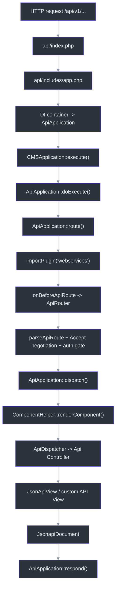
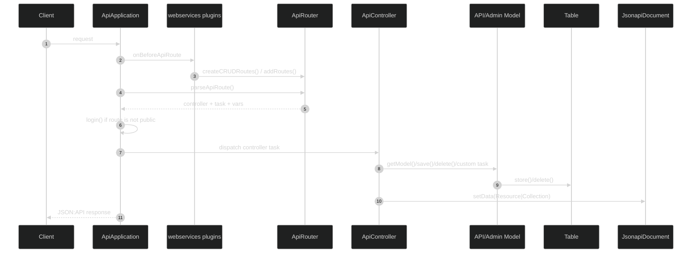

# Joomla 6 REST API: a complete guide based on the core source

This article is based solely on the Joomla 6.0.3 source in `Joomla Core 6.0.3 (version-pinned source snapshot)`. It describes the code and its actual relationships without relying on local documentation.

Joomla 6 implements its REST API with a dedicated `ApiApplication`, a route-registration stage provided by `webservices` plugins, a separate MVC layer in `api/components`, and reuse of administrator models and tables through `ApiMVCFactory`. (`api/index.php:31`, `api/includes/app.php:43`, `libraries/src/Application/ApiApplication.php:40`, `libraries/src/MVC/Factory/ApiMVCFactory.php:23`).

## Overall architecture





## 1. Entering the API and starting `ApiApplication`

Execution starts in `api/index.php`: the file sets the minimum PHP version, defines `_JEXEC`, and passes control to `api/includes/app.php`. (`api/index.php:13`, `api/index.php:28`, `api/index.php:31`).

`api/includes/app.php` loads `api/includes/defines.php` and then `api/includes/framework.php`, obtains an `ApiApplication` instance from the DI container, makes it the global application, and calls `execute()`. (`api/includes/app.php:20`, `api/includes/app.php:22`, `api/includes/app.php:27`, `api/includes/app.php:43`, `api/includes/app.php:50`).

Path definitions matter here. In the API client, `JPATH_BASE` points to `/api`, while `JPATH_ROOT` and `JPATH_ADMINISTRATOR` are resolved relative to the site root. The API can therefore access both:

- its own API classes in `api/components/...`
- administrator component providers, models, and tables in `administrator/components/...`

These definitions are implemented in `api/includes/defines.php`. (`api/includes/defines.php:13`, `api/includes/defines.php:20`, `api/includes/defines.php:24`, `api/includes/defines.php:31`).

The application service provider registers `ApiApplication`. The container creates it and attaches the dispatcher, logger, session, and menu factory, making the resulting object the standard API request execution entry point. (`libraries/src/Service/Provider/Application.php:177`).

## 2. The top-level execution cycle

`ApiApplication` extends `CMSApplication`, so the top-level cycle runs through `CMSApplication::execute()`. This method:

- performs system preparation;
- imports the `behaviour` and `system` plugin groups;
- dispatches `onBeforeExecute`;
- calls `doExecute()`;
- renders the document;
- dispatches `onBeforeRespond` and `onAfterRespond`;
- sends the response to the client

(`libraries/src/Application/CMSApplication.php:297`, `libraries/src/Application/CMSApplication.php:306`, `libraries/src/Application/CMSApplication.php:309`, `libraries/src/Application/CMSApplication.php:319`, `libraries/src/Application/CMSApplication.php:349`, `libraries/src/Application/CMSApplication.php:356`).

The API-specific sequence inside `ApiApplication::doExecute()` is short: `initialiseApp()`, followed by `route()`, and then `dispatch()`. (`libraries/src/Application/ApiApplication.php:91`).

This establishes the core architectural order: HTTP routing, negotiation, and the authentication gate precede component MVC; component dispatch and JSON:API serialization follow them.

## 3. How the API collects routes

### 3.1. The role of `webservices` plugins

In `ApiApplication::route()`, the container supplies an `ApiRouter`. Joomla then imports the `webservices` plugin group and dispatches `onBeforeApiRoute`, passing the router to the event. (`libraries/src/Application/ApiApplication.php:229`, `libraries/src/Application/ApiApplication.php:234`, `libraries/src/Application/ApiApplication.php:237`).

`PluginHelper::importPlugin()` selects enabled plugins from the requested group. `PluginHelper::import()` loads each plugin through `bootPlugin()` and registers its listeners or subscribers with the dispatcher. (`libraries/src/Plugin/PluginHelper.php:148`, `libraries/src/Plugin/PluginHelper.php:179`, `libraries/src/Plugin/PluginHelper.php:221`, `libraries/src/Plugin/PluginHelper.php:241`).

The modern core pattern for these plugins consists of:

1. a manifest with `group="webservices"` and a namespace mapped to `src` (`plugins/webservices/content/content.xml:2`)
2. a `services/provider.php` file that registers the plugin in the container (`plugins/webservices/content/services/provider.php:20`)
3. a plugin class under `src/Extension/...` implementing `SubscriberInterface` (`plugins/webservices/content/src/Extension/Content.php:28`)

For a plugin implementing `SubscriberInterface`, `CMSPlugin::registerListeners()` adds it directly to the dispatcher as a subscriber. (`libraries/src/Plugin/CMSPlugin.php:298`).

### 3.2. What `onBeforeApiRoute` does

`BeforeApiRouteEvent` requires the `router` argument and exposes it through `getRouter()`. (`libraries/src/Event/Application/BeforeApiRouteEvent.php:17`).

A typical webservice plugin subscribes to `onBeforeApiRoute` through `getSubscribedEvents()` and adds routes in its handler. For example, `content` registers articles, categories, fields, and content history routes. (`plugins/webservices/content/src/Extension/Content.php:37`, `plugins/webservices/content/src/Extension/Content.php:53`).

In Joomla 6, the `webservices` plugin defines the REST API's HTTP surface. Route registration does not belong in the controller, component provider, or site-side component router.

## 4. How the CRUD helper works and when it is insufficient

`ApiRouter::createCRUDRoutes()` creates exactly five routes:

1. `GET <base>` -> `controller.displayList`
2. `GET <base>/:id` -> `controller.displayItem`
3. `POST <base>` -> `controller.add`
4. `PATCH <base>/:id` -> `controller.edit`
5. `DELETE <base>/:id` -> `controller.delete`

For `GET`, the helper automatically adds `public => $publicGets` to the defaults. For `POST/PATCH/DELETE`, it uses the original defaults without this addition. (`libraries/src/Router/ApiRouter.php:51`).

This is the standard core approach to CRUD routes:

```php
$router->createCRUDRoutes(
    'v1/content/articles',
    'articles',
    ['component' => 'com_content']
);
```

The standard CRUD endpoints in `content`, `users`, `menus`, `tags`, `redirect`, and other core plugins use the same approach. (`plugins/webservices/content/src/Extension/Content.php:57`, `plugins/webservices/users/src/Extension/Users.php:56`, `plugins/webservices/menus/src/Extension/Menus.php:56`, `plugins/webservices/tags/src/Extension/Tags.php:55`, `plugins/webservices/redirect/src/Extension/Redirect.php:55`).

The helper only covers numeric identifiers. For more complex requirements, core plugins create `Route` objects directly.

| Scenario | Core implementation |
| --- | --- |
| Non-numeric key | `languages` uses the `([A-Z0-9_]+)` regex for overrides (`plugins/webservices/languages/src/Extension/Languages.php:87`) |
| Path instead of an ID | `media` builds routes with `:path` and the `.*` / `.*\/` regexes (`plugins/webservices/media/src/Extension/Media.php:95`) |
| Dedicated service actions | `config` and `joomlaupdate` add explicit `Route` objects with their own `controller.task` values (`plugins/webservices/config/src/Extension/Config.php:52`, `plugins/webservices/joomlaupdate/src/Extension/Joomlaupdate.php:42`) |
| Dynamic routes | `languages` first reads the administrator `Languages` model, then generates URLs for each language (`plugins/webservices/languages/src/Extension/Languages.php:75`) |

## 5. What `ApiApplication::route()` does after route registration

After `onBeforeApiRoute`, the application:

1. handles preflight through `handlePreflight()`;
2. calls `ApiRouter::parseApiRoute($method)`;
3. negotiates content using `Accept`;
4. writes `controller`, `task`, and route variables to the input;
5. dispatches `onAfterApiRoute`;
6. unless the route is `public`, requires successful authentication with the `core.login.api` action

(`libraries/src/Application/ApiApplication.php:246`, `libraries/src/Application/ApiApplication.php:248`, `libraries/src/Application/ApiApplication.php:255`, `libraries/src/Application/ApiApplication.php:287`, `libraries/src/Application/ApiApplication.php:310`, `libraries/src/Application/ApiApplication.php:315`).

`parseApiRoute()` returns three values rather than an entire component:

- `controller`
- `task`
- `vars`

Here, `vars` combines route defaults with path parameters. (`libraries/src/Router/ApiRouter.php:89`).

A webservice plugin therefore controls both the URL and the default values passed into the MVC layer. Core plugins make extensive use of this:

- `component => com_content` for standard CRUD (`plugins/webservices/content/src/Extension/Content.php:57`)
- `extension => com_content` for content categories (`plugins/webservices/content/src/Extension/Content.php:63`)
- `context => com_content.article` for fields (`plugins/webservices/content/src/Extension/Content.php:85`)
- `component_name` for `config` (`plugins/webservices/config/src/Extension/Config.php:60`)
- `type_alias` and `type_id` for content history (`plugins/webservices/content/src/Extension/Content.php:121`)
- `lang_code` and `app` for language overrides (`plugins/webservices/languages/src/Extension/Languages.php:92`)

## 6. From the route to the component and API MVC

After routing, `ApiApplication::dispatch()` loads the document, dispatches `onAfterInitialiseDocument`, calls `ComponentHelper::renderComponent($component)`, and then dispatches `onAfterDispatch`. (`libraries/src/Application/ApiApplication.php:421`, `libraries/src/Application/ApiApplication.php:427`, `libraries/src/Application/ApiApplication.php:433`, `libraries/src/Application/ApiApplication.php:437`).

`ComponentHelper::renderComponent()` performs three main steps:

1. sets `JPATH_COMPONENT` to `JPATH_BASE . '/components/' . $option`
2. checks that the component is enabled
3. runs `bootComponent($option)->getDispatcher($app)->dispatch()`

(`libraries/src/Component/ComponentHelper.php:313`, `libraries/src/Component/ComponentHelper.php:349`, `libraries/src/Component/ComponentHelper.php:355`).

### 6.1. Why the component provider comes from `administrator`

`bootComponent()` always loads `administrator/components/com_xxx/services/provider.php`. This location is hard-coded in `ExtensionManagerTrait::bootComponent()`. (`libraries/src/Extension/ExtensionManagerTrait.php:42`).

The administrator application and the API therefore share the component's base service container. This is why the component provider belongs in the administrator portion of the extension.

### 6.2. How the dispatcher is selected

`ComponentDispatcherFactory` looks for the `...\Api\Dispatcher\Dispatcher` class. If it is absent and the current application is the API, the factory supplies the generic `ApiDispatcher`. (`libraries/src/Dispatcher/ComponentDispatcherFactory.php:67`).

`ApiDispatcher`:

- reads `task` from the input;
- builds the controller configuration;
- selects a controller using the current application prefix, `Api`;
- calls `execute($task)`

(`libraries/src/Dispatcher/ApiDispatcher.php:44`).

### 6.3. How the controller, view, model, and table are selected

The following lookup boundaries are significant.

| Layer | Core lookup location | Fallback |
| --- | --- | --- |
| controller | `...\Api\Controller\...` | no |
| view | `...\Api\View\...` | no |
| model | `Api` first, then `Administrator` | yes |
| table | `Api` first, then `Administrator` | yes |

Source evidence:

- `MVCFactory::createController()` searches only the current prefix (`libraries/src/MVC/Factory/MVCFactory.php:84`)
- `MVCFactory::createView()` searches only the current prefix (`libraries/src/MVC/Factory/MVCFactory.php:181`)
- `ApiMVCFactory::createModel()` and `createTable()` try `Api` first, then repeat the lookup with the `Administrator` prefix (`libraries/src/MVC/Factory/ApiMVCFactory.php:23`, `libraries/src/MVC/Factory/ApiMVCFactory.php:34`, `libraries/src/MVC/Factory/ApiMVCFactory.php:46`, `libraries/src/MVC/Factory/ApiMVCFactory.php:57`)

### 6.4. An important boundary: `Site` models are not part of this chain

For the standard REST API, fallback is limited to `Api -> Administrator`. `Site` models are not included automatically: `ApiMVCFactory` repeats the lookup only with the `Administrator` prefix, never with `Site`. (`libraries/src/MVC/Factory/ApiMVCFactory.php:34`, `libraries/src/MVC/Factory/ApiMVCFactory.php:57`).

The statement that "API CRUD inherits site-side models" is therefore incorrect. The actual rules are:

- API controllers and API view classes must exist separately in `api/components`
- API models and tables do not need duplicate implementations when the administrator code is suitable
- site-side models are not part of the standard REST resolution chain

## 7. JSON:API response layer

The base `JsonApiView` builds a `Resource` or `Collection`, adds pagination links, and places the result in the document. (`libraries/src/MVC/View/JsonApiView.php:103`, `libraries/src/MVC/View/JsonApiView.php:145`, `libraries/src/MVC/View/JsonApiView.php:196`, `libraries/src/MVC/View/JsonApiView.php:200`, `libraries/src/MVC/View/JsonApiView.php:249`).

`JsonapiDocument`:

- sets the MIME type to `application/vnd.api+json`
- accepts an `ElementInterface` through `setData()`
- during `render()`, serializes the JSON:API document with `json_encode()`

(`libraries/src/Document/JsonapiDocument.php:35`, `libraries/src/Document/JsonapiDocument.php:48`, `libraries/src/Document/JsonapiDocument.php:57`, `libraries/src/Document/JsonapiDocument.php:140`).

The document is selected from the `format` that `ApiApplication::route()` writes to the input after content negotiation. (`libraries/src/Application/ApiApplication.php:279`, `libraries/src/Factory.php:762`, `libraries/src/Factory.php:773`, `libraries/src/Document/Factory.php:27`).

## 8. ACL in the REST request flow

Joomla REST authorization is distributed across several layers.

### 8.1. Route-level gate

For a route without the `public` flag, `ApiApplication::route()` requires successful authentication with the `core.login.api` action. (`libraries/src/Application/ApiApplication.php:315`).

The API also uses a separate authentication stack: `ApiApplication` sets `$authenticationPluginType` to `api-authentication`, and `CMSApplication::login()` subsequently invokes authentication and user plugins. (`libraries/src/Application/ApiApplication.php:56`, `libraries/src/Application/CMSApplication.php:901`, `libraries/src/Application/CMSApplication.php:904`, `libraries/src/Application/CMSApplication.php:908`, `libraries/src/Application/CMSApplication.php:951`).

### 8.2. Controller-level ACL

The base `ApiController` checks:

- `add()` through `allowAdd()`
- `edit()` through `allowEdit()`
- `delete()` against the component's `core.delete` permission

(`libraries/src/MVC/Controller/ApiController.php:273`, `libraries/src/MVC/Controller/ApiController.php:342`, `libraries/src/MVC/Controller/ApiController.php:363`).

By default:

- `allowAdd()` permits the operation when the user has `core.create` on the component or has authorized categories (`libraries/src/MVC/Controller/ApiController.php:537`)
- `allowEdit()` checks only `core.edit` on the component (`libraries/src/MVC/Controller/ApiController.php:520`)

The standard `allowEdit()` does not perform item-level authorization. To check assets such as `com_example.item.<id>` or implement `core.edit.own`, provide that logic in your API controller.

Core components demonstrate both approaches:

- `com_media` overrides `allowAdd()`, `allowEdit()`, and `allowDelete()` for its own semantics (`api/components/com_media/src/Controller/MediaController.php:232`, `api/components/com_media/src/Controller/MediaController.php:287`, `api/components/com_media/src/Controller/MediaController.php:389`)
- `com_joomlaupdate` disables inherited CRUD checks and protects its custom methods with a dedicated token through `validateUpdateToken()` (`api/components/com_joomlaupdate/src/Controller/BaseController.php:19`, `api/components/com_joomlaupdate/src/Controller/UpdatesController.php:186`, `api/components/com_joomlaupdate/src/Controller/UpdatesController.php:203`)

### 8.3. Model-level ACL

The delete pipeline adds another authorization layer in `AdminModel::delete()`: after controller-level authorization, the model calls `canDelete($table)`. (`libraries/src/MVC/Model/AdminModel.php:848`).

The base implementation checks `core.delete` on the component (`libraries/src/MVC/Model/AdminModel.php:763`), but administrator models often override this method. Their rules therefore also apply to REST when the API falls back to those models.

Examples:

- `ArticleModel::canDelete()` requires the trashed state and `core.delete` on the `com_content.article.<id>` asset (`administrator/components/com_content/src/Model/ArticleModel.php:284`)
- `ContactModel::canDelete()` requires the trashed state and `core.delete` on the contact's category (`administrator/components/com_contact/src/Model/ContactModel.php:120`)

### 8.4. Save-level domain rules

`ApiController::save()` reads the JSON body, validates the data with the form, and calls `$model->save($validData)`. (`libraries/src/MVC/Controller/ApiController.php:411`).

When an administrator model is used, its full domain contract remains in effect.

For example:

- `ArticleModel::save()` normalizes metadata, images, and URLs, can create a category, invokes workflow hooks, and then calls `parent::save()` (`administrator/components/com_content/src/Model/ArticleModel.php:642`)
- `ContactModel::save()` can also create a category and normalizes links before calling `parent::save()` (`administrator/components/com_contact/src/Model/ContactModel.php:270`)

Reusing administrator models gives REST access to the component's existing business rules as well as its data.

## 9. Events and triggers that run through REST

The following list includes only behavior confirmed by the source code.

| Stage | Event / trigger | Source location |
| --- | --- | --- |
| execute cycle | `onBeforeExecute`, `onBeforeRespond`, `onAfterRespond` | `libraries/src/Application/CMSApplication.php:309`, `libraries/src/Application/CMSApplication.php:349`, `libraries/src/Application/CMSApplication.php:356` |
| Shared bootstrap | Importing the `behaviour` and `system` groups | `libraries/src/Application/CMSApplication.php:306` |
| API route registration | `onBeforeApiRoute` | `libraries/src/Application/ApiApplication.php:237` |
| After routing | `onAfterApiRoute` | `libraries/src/Application/ApiApplication.php:310` |
| document init | `onAfterInitialiseDocument` | `libraries/src/Application/ApiApplication.php:427` |
| After component dispatch | `onAfterDispatch` | `libraries/src/Application/ApiApplication.php:437` |
| Authentication pipeline | `onUserLogin`, `onUserAfterLogin`, `onUserLoginFailure`, and the related authentication flow | `libraries/src/Application/CMSApplication.php:951`, `libraries/src/Application/CMSApplication.php:977`, `libraries/src/Application/CMSApplication.php:992` |
| CRUD save | `onContentBeforeSave`, `onContentAfterSave` | `libraries/src/MVC/Model/AdminModel.php:193`, `libraries/src/MVC/Model/AdminModel.php:1304`, `libraries/src/MVC/Model/AdminModel.php:1332`, `libraries/src/MVC/Model/AdminModel.php:1357` |
| CRUD delete | `onContentBeforeDelete`, `onContentAfterDelete` | `libraries/src/MVC/Model/AdminModel.php:193`, `libraries/src/MVC/Model/AdminModel.php:865`, `libraries/src/MVC/Model/AdminModel.php:874`, `libraries/src/MVC/Model/AdminModel.php:946` |
| table observers | `onTableBeforeStore`, `onTableAfterStore`, `onTableBeforeDelete`, `onTableAfterDelete` | `libraries/src/Table/Table.php:879`, `libraries/src/Table/Table.php:901`, `libraries/src/Table/Table.php:1004`, `libraries/src/Table/Table.php:1062`, `libraries/src/Table/Table.php:1099`, `libraries/src/Table/Table.php:1134` |
| JSON:API field extension | `onApiGetFields` | `libraries/src/MVC/View/JsonApiView.php:182`, `libraries/src/MVC/View/JsonApiView.php:237`, `libraries/src/MVC/View/Event/OnGetApiFields.php:17` |
| Content rendering inside the API view | `onContentPrepare` in `com_content` | `api/components/com_content/src/View/Articles/JsonapiView.php:193` |

A Joomla REST endpoint remains connected to the rest of the core. When it uses `AdminModel`, it participates in content events, table observers, and model-specific save/delete behavior in almost the same way as the administrator interface. (`libraries/src/MVC/Model/AdminModel.php:1278`, `libraries/src/Table/Table.php:879`).

## 10. A custom webservice plugin and API component skeleton

The following skeleton combines patterns from real core code in `content`, `config`, `media`, and `joomlaupdate`; it is not copied from a single component. (`plugins/webservices/content/content.xml:2`, `plugins/webservices/content/services/provider.php:20`, `plugins/webservices/content/src/Extension/Content.php:53`, `plugins/webservices/config/src/Extension/Config.php:52`, `plugins/webservices/media/src/Extension/Media.php:95`, `administrator/components/com_config/services/provider.php:29`).

### 10.1. The `webservices` plugin manifest

```xml
<?xml version="1.0" encoding="UTF-8"?>
<extension type="plugin" group="webservices" method="upgrade">
    <name>plg_webservices_inventory</name>
    <author>Your Team</author>
    <version>1.0.0</version>
    <description>PLG_WEBSERVICES_INVENTORY_XML_DESCRIPTION</description>
    <namespace path="src">Joomla\Plugin\WebServices\Inventory</namespace>
    <files>
        <folder plugin="inventory">services</folder>
        <folder>src</folder>
    </files>
</extension>
```

### 10.2. The plugin provider

```php
<?php

defined('_JEXEC') or die;

use Joomla\CMS\Extension\PluginInterface;
use Joomla\CMS\Factory;
use Joomla\CMS\Plugin\PluginHelper;
use Joomla\DI\Container;
use Joomla\DI\ServiceProviderInterface;
use Joomla\Plugin\WebServices\Inventory\Extension\Inventory;

return new class () implements ServiceProviderInterface {
    public function register(Container $container): void
    {
        $container->set(
            PluginInterface::class,
            function (Container $container) {
                $plugin = new Inventory(
                    (array) PluginHelper::getPlugin('webservices', 'inventory')
                );

                $plugin->setApplication(Factory::getApplication());

                return $plugin;
            }
        );
    }
};
```

### 10.3. A plugin registering CRUD routes and a custom route

```php
<?php

namespace Joomla\Plugin\WebServices\Inventory\Extension;

use Joomla\CMS\Event\Application\BeforeApiRouteEvent;
use Joomla\CMS\Plugin\CMSPlugin;
use Joomla\Event\SubscriberInterface;
use Joomla\Router\Route;

defined('_JEXEC') or die;

final class Inventory extends CMSPlugin implements SubscriberInterface
{
    public static function getSubscribedEvents(): array
    {
        return [
            'onBeforeApiRoute' => 'onBeforeApiRoute',
        ];
    }

    public function onBeforeApiRoute(BeforeApiRouteEvent $event): void
    {
        $router = $event->getRouter();

        $router->createCRUDRoutes(
            'v1/inventory/items',
            'items',
            ['component' => 'com_inventory']
        );

        $router->addRoutes([
            new Route(
                ['POST'],
                'v1/inventory/items/:id/publish',
                'items.publish',
                ['id' => '(\d+)'],
                ['component' => 'com_inventory']
            ),
        ]);
    }
}
```

### 10.4. The administrator component provider

The component provider must be located at `administrator/components/com_inventory/services/provider.php`, because `bootComponent()` looks for it there. (`libraries/src/Extension/ExtensionManagerTrait.php:42`).

```php
<?php

defined('_JEXEC') or die;

use Joomla\CMS\Dispatcher\ComponentDispatcherFactoryInterface;
use Joomla\CMS\Extension\ComponentInterface;
use Joomla\CMS\Extension\MVCComponent;
use Joomla\CMS\Extension\Service\Provider\ComponentDispatcherFactory;
use Joomla\CMS\Extension\Service\Provider\MVCFactory;
use Joomla\CMS\MVC\Factory\MVCFactoryInterface;
use Joomla\Component\Inventory\Administrator\Extension\InventoryComponent;
use Joomla\DI\Container;
use Joomla\DI\ServiceProviderInterface;

return new class () implements ServiceProviderInterface {
    public function register(Container $container): void
    {
        $container->registerServiceProvider(new MVCFactory('\\Joomla\\Component\\Inventory'));
        $container->registerServiceProvider(new ComponentDispatcherFactory('\\Joomla\\Component\\Inventory'));

        $container->set(
            ComponentInterface::class,
            function (Container $container) {
                $component = new InventoryComponent(
                    $container->get(ComponentDispatcherFactoryInterface::class)
                );

                $component->setMVCFactory($container->get(MVCFactoryInterface::class));

                return $component;
            }
        );
    }
};
```

```php
<?php

namespace Joomla\Component\Inventory\Administrator\Extension;

use Joomla\CMS\Extension\MVCComponent;

defined('_JEXEC') or die;

final class InventoryComponent extends MVCComponent
{
}
```

### 10.5. An API controller with item-level ACL

```php
<?php

namespace Joomla\Component\Inventory\Api\Controller;

use Joomla\CMS\Access\Exception\NotAllowed;
use Joomla\CMS\Language\Text;
use Joomla\CMS\MVC\Controller\ApiController;
use RuntimeException;

defined('_JEXEC') or die;

final class ItemsController extends ApiController
{
    protected $contentType = 'items';
    protected $default_view = 'items';

    protected function allowAdd($data = [])
    {
        $user = $this->app->getIdentity();

        return $user->authorise('core.create', 'com_inventory')
            || count($user->getAuthorisedCategories('com_inventory', 'core.create'));
    }

    protected function allowEdit($data = [], $key = 'id')
    {
        $user = $this->app->getIdentity();
        $recordId = (int) ($data[$key] ?? $this->input->getInt($key));

        if ($recordId > 0 && $user->authorise('core.edit', 'com_inventory.item.' . $recordId)) {
            return true;
        }

        if ($recordId > 0 && $user->authorise('core.edit.own', 'com_inventory')) {
            $model = $this->getModel('Item', '', ['ignore_request' => true]);
            $item = $model ? $model->getItem($recordId) : null;

            return $item && (int) $item->created_by === (int) $user->id;
        }

        return false;
    }

    public function publish()
    {
        $id = $this->input->getInt('id');

        if (!$this->app->getIdentity()->authorise('core.edit.state', 'com_inventory.item.' . $id)) {
            throw new NotAllowed('JLIB_APPLICATION_ERROR_EDITSTATE_NOT_PERMITTED', 403);
        }

        $model = $this->getModel('Item', '', ['ignore_request' => true]);

        if (!$model) {
            throw new RuntimeException(Text::_('JLIB_APPLICATION_ERROR_MODEL_CREATE'));
        }

        if (!$model->publish([$id], 1)) {
            throw new RuntimeException($model->getError());
        }

        return $this->displayItem($id);
    }
}
```

### 10.6. A thin JSON:API view

```php
<?php

namespace Joomla\Component\Inventory\Api\View\Items;

use Joomla\CMS\MVC\View\JsonApiView as BaseJsonApiView;

defined('_JEXEC') or die;

final class JsonapiView extends BaseJsonApiView
{
    protected $fieldsToRenderList = [
        'id',
        'title',
        'state',
        'catid',
        'created_by',
    ];

    protected $fieldsToRenderItem = [
        'id',
        'title',
        'alias',
        'state',
        'catid',
        'created_by',
        'created',
        'modified',
    ];
}
```

### 10.7. When a separate API model is unnecessary

If the component already provides suitable administrator `ItemModel`, `ItemsModel`, and `ItemTable` classes, a separate API model is unnecessary. `ApiMVCFactory` tries `Api` first, followed by `Administrator`. (`libraries/src/MVC/Factory/ApiMVCFactory.php:34`, `libraries/src/MVC/Factory/ApiMVCFactory.php:57`).

```php
<?php

namespace Joomla\Component\Inventory\Administrator\Model;

use Joomla\CMS\MVC\Model\AdminModel;
use Joomla\CMS\MVC\Model\ListModel;

final class ItemModel extends AdminModel
{
}

final class ItemsModel extends ListModel
{
}
```

### 10.8. When a separate API model is required

Implement a separate API model when:

- the URL identifies an item by a path or slug rather than a numeric ID;
- the endpoint does not operate on a regular database table;
- different query state or a different data source is required.

The core example is `com_media`, which provides its own API `MediaModel` and `MediumModel` classes. (`api/components/com_media/src/Model/MediaModel.php:31`, `api/components/com_media/src/Model/MediumModel.php:32`).

## 11. Summary

The Joomla 6.0.3 source establishes the following standard REST API flow:

1. `ApiApplication` initializes the API client and imports `webservices` plugins.
2. A `webservices` plugin registers routes and route defaults in `onBeforeApiRoute`.
3. `ApiRouter` resolves the request to `controller.task`.
4. `ApiDispatcher` locates the API controller.
5. `ApiController` and the API view implement REST behavior and build the JSON:API response.
6. Models and tables may fall back to `Administrator`, but not to `Site`.
7. When `AdminModel` is used, REST runs the same save/delete events, ACL rules, and table observers as the administrator interface.

This is the standard core approach to implementing custom CRUD endpoints in Joomla 6.


